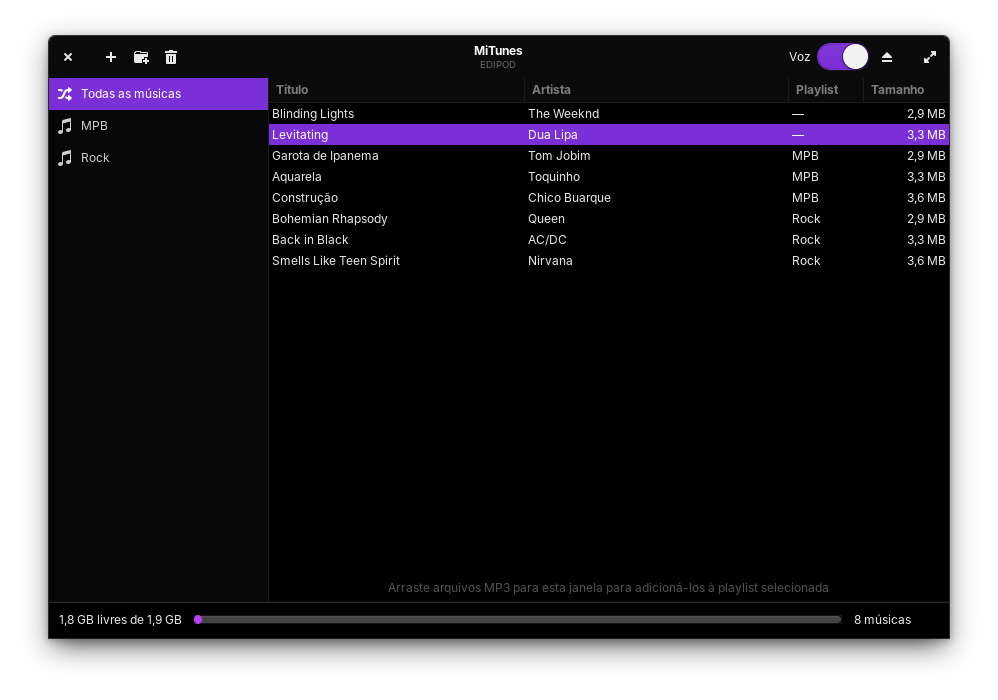
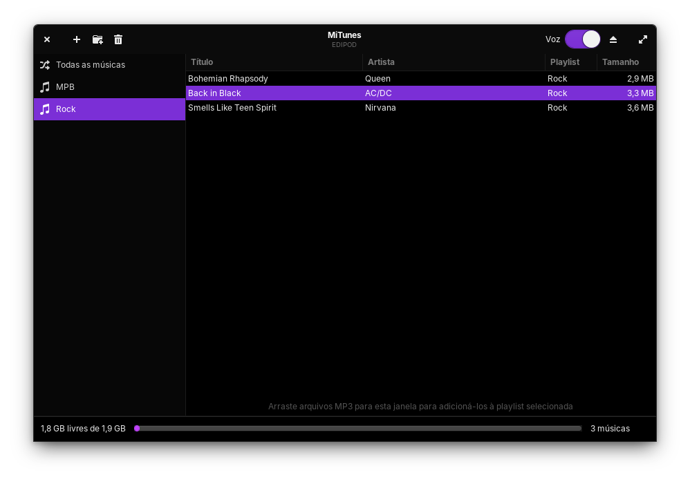

<p align="center"></p>

# MiTunes (MiPod)

Gerenciador do **iPod Shuffle 4ª geração** para Linux, no lugar do iTunes.



Jogue arquivos MP3/M4A na pasta `music` do iPod (ou use a janela do MiTunes) e eles passam a tocar.
O firmware original da Apple continua intocado: o MiTunes recria a parte que o iTunes fazia, gerando o
banco de músicas que o iPod lê (`iPod_Control/iTunes/iTunesSD`) e as vozes do VoiceOver.

## Recursos
- Janela GTK 3 (visual nativo do elementary OS): adicionar músicas (botão ou arrastar e soltar), playlists, remover, ejetar
- Subpastas de `music` viram playlists
- VoiceOver em português (espeak): o iPod fala o nome da música, artista e playlist
- Serviço que atualiza o iPod sozinho ao conectar ou quando a pasta `music` muda
- Detecta e remove o vírus `Activador.vbs` (Houdini/H-worm) se estiver no iPod

## Playlists
Cada subpasta de `music` vira uma playlist, mostrada na barra lateral:



## Requisitos
- **iPod Shuffle 4ª geração**; outros modelos não foram testados
- Linux com Python 3, GTK 3 (PyGObject) e systemd do usuário; feito para o elementary OS
- `espeak` para as vozes (opcional)
- O iPod aparece como disco em `/media/<usuário>/` com a pasta `iPod_Control`. O serviço automático só vigia o volume de
  nome **EDIPOD**; a janela do MiTunes acha qualquer iPod montado, mas prefere esse nome

## Instalação
```sh
git clone https://github.com/TraspJorge/MiPod.git
cd MiPod
sh instalar.sh
```
Instala em `~/.local/share/mitunes`, cria o atalho no menu de aplicativos (comando `mitunes`) e o serviço
`mitunes-vigia` (systemd do usuário). Não usa `sudo`.

### Desinstalar
```sh
systemctl --user disable --now mitunes-vigia.service
rm -f ~/.config/systemd/user/mitunes-vigia.service ~/.local/bin/mitunes \
      ~/.local/share/applications/mitunes.desktop ~/.local/share/icons/hicolor/scalable/apps/mitunes.svg
rm -rf ~/.local/share/mitunes
systemctl --user daemon-reload
```
Suas músicas no iPod não são tocadas.

## O que ele altera no iPod
- **Recria** o banco `iPod_Control/iTunes/iTunesSD` e a pasta das vozes (`iPod_Control/Speakable`) a cada sincronização
- **Não mexe** nas suas músicas: elas ficam na pasta `music`
- Avisa e remove o arquivo `Activador.vbs` (vírus Houdini/H-worm) se estiver no iPod

Mesmo assim, faça uma cópia da pasta `iPod_Control` antes da primeira vez, se o iPod tiver algo importante.

## Problemas comuns
| Sintoma | O que fazer |
|---|---|
| A janela diz que não achou o iPod | Confira se ele está montado em `/media/<usuário>/` e tem a pasta `iPod_Control` |
| O iPod não atualiza sozinho | O serviço só vigia o volume `EDIPOD`; veja `systemctl --user status mitunes-vigia` |
| O iPod não fala o nome das músicas | Instale o `espeak` e sincronize de novo |
| Músicas novas não tocam | Use MP3 ou M4A dentro da pasta `music` e espere a sincronização terminar antes de ejetar |

## Arquivos
| Arquivo | Função |
|---|---|
| `mitunes.py` | Janela do MiTunes |
| `shuffle_sync.py` | Gera o `iTunesSD` e as vozes (pode ser usado sozinho: `python3 shuffle_sync.py /media/$USER/EDIPOD`) |
| `vigia.py` | Atualização automática ao conectar o iPod |
| `instalar.sh` | Instalador |

## Créditos e licença
Formato do `iTunesSD` baseado em [nims11/IPod-Shuffle-4g](https://github.com/nims11/IPod-Shuffle-4g). Licença GPL-2.0.
